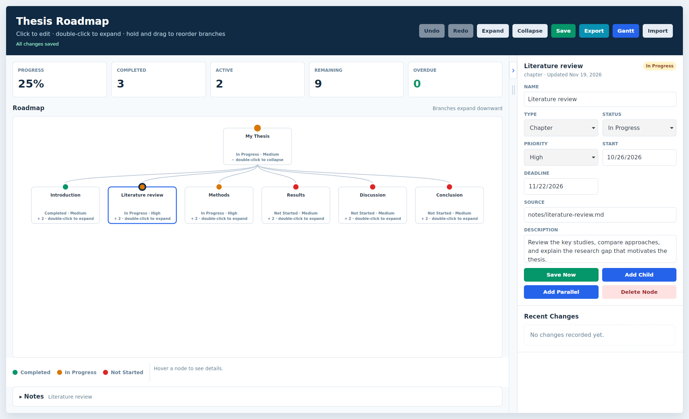
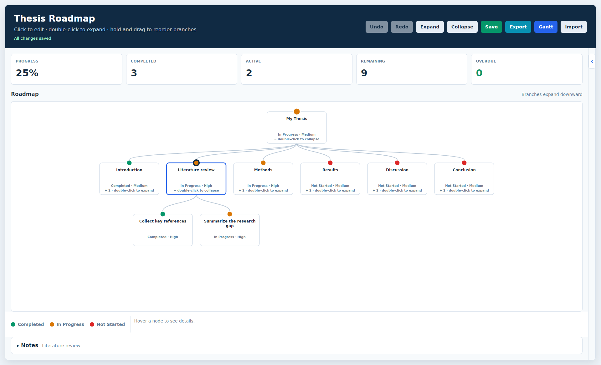
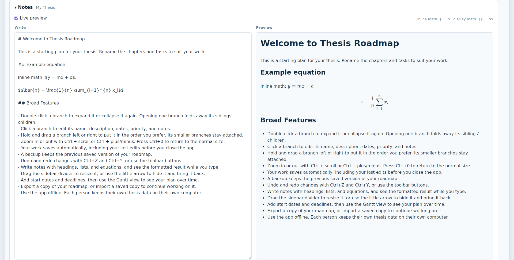
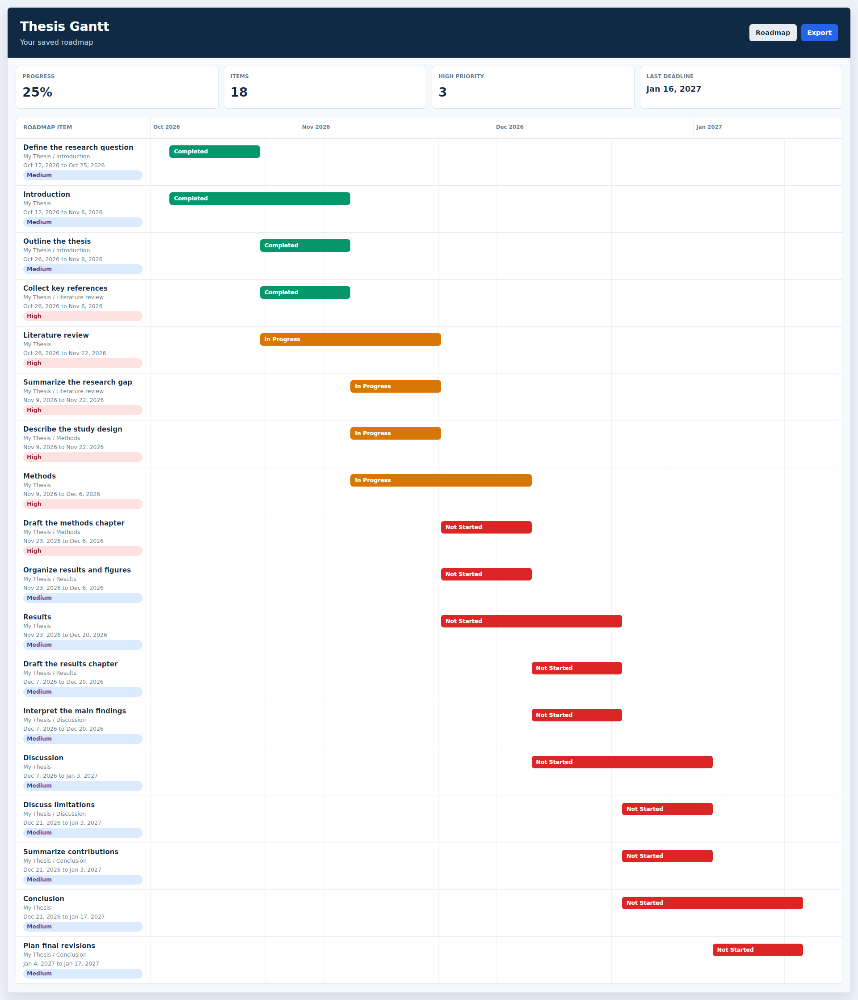

# Thesis Roadmap

An offline desktop app for planning and writing a thesis. Organize chapters and
tasks as a map, set dates, take notes with live equations, and track progress.

## Preview

Screenshots from the Linux desktop app using fictional example data.

**Roadmap and details sidebar** — track progress and edit chapters, dates, and priorities.



<details>
<summary>Expanded branches and a wider map</summary>

Expand a chapter to see its tasks, and hide the sidebar to give the map more room.



</details>

<details>
<summary>Notes with live Markdown and LaTeX preview</summary>

Write and read notes in one continuous editor. Only the formula or formatted
phrase at the cursor exposes its source; everything else stays rendered. The
example equation and Broad Features guide are included in the starter Notes.



</details>

<details>
<summary>Gantt timeline</summary>

See an example schedule with completed, active, and planned work, start dates,
and deadlines.



</details>

## Install for your user account

The native desktop app is for Linux. It requires Python 3.10+, PyGObject, GTK 3,
and WebKitGTK 4.0 or 4.1. The installer checks these before installing anything.

1. Download and extract the latest `roadmap-*.tar.gz` from
   [Releases](https://github.com/ps143991/roadmap/releases).
   Alternatively, download **Code → Download ZIP** or clone this repository.
2. Open a terminal in the extracted folder and run:

   ```bash
   bash install.sh
   ```

3. Open **Thesis Roadmap** from your applications menu. You can pin it to the dock
   or favorites like any other app.

The app is copied into your own `~/.local/share/thesis-roadmap/app/` folder and a
shortcut is added to `~/.local/share/applications/`. You can remove the downloaded
folder after installation. Installing the app itself does not need administrator
access.

For a shortcut on the Desktop as well:

```bash
bash install.sh --desktop
```

Some desktop environments require right-clicking that shortcut and choosing
**Allow Launching**. The applications-menu shortcut works without that step.

### If desktop dependencies are missing

On Debian/Ubuntu, the optional setup below installs the required operating-system
libraries, then performs the same per-user app installation. This optional step
requires `sudo`; skip it if the normal installation already works.

```bash
bash install.sh --install-deps
```

For other Linux distributions, install Python 3.10+, PyGObject, GTK 3, and the
WebKit2 introspection package for API 4.0 or 4.1 using your package manager, then
run `bash install.sh`.

## Your thesis data

A new user starts with a general, editable outline: Introduction, Literature
review, Methods, Results, Discussion, and Conclusion. There are no personal
thesis notes, project-specific results, histories, or backups in this repository.

Your own work is created on first launch in:

```text
~/.local/share/thesis-roadmap/data/roadmap_data.json
~/.local/share/thesis-roadmap/data/roadmap_data.backup.json
```

`XDG_DATA_HOME` is respected if you use a different data location. Browser recovery
storage is kept in a `webview/` subfolder. Program files and user data are separate,
so reinstalling or updating the program preserves your work.

Use **Export** to save a portable JSON copy and **Import** to load an existing
roadmap. An imported roadmap replaces the current one; **Undo** reverses that
change during the current app session. The backup contains the previous save;
keep exported copies if you want longer-term versions.

## Example equation

Notes render Markdown and equations inside a continuous editor. Move the cursor
into a formula or formatted phrase to reveal only that unit's syntax. Move out
of it to restore its rendered form, even within the same paragraph or list item.
The surrounding text stays rendered and ordinary text keeps a consistent weight
and color. Turn **Live preview** off to see all the source in the same editor;
the preference is remembered.

The starter Notes include this example:

```text
Inline math: $y = mx + b$.

$$\bar{x} = \frac{1}{n} \sum_{i=1}^{n} x_i$$
```

## Broad Features

- Double-click a branch to expand it or collapse it again. Opening one branch folds away its siblings' children.
- Click a branch to edit its name, description, dates, priority, and notes.
- Hold and drag a branch left or right to put it in the order you prefer. Its smaller branches stay attached.
- Zoom in or out with Ctrl + scroll or Ctrl + plus/minus. Press Ctrl+0 to return to the normal size.
- Your work saves automatically, including your last edits before you close the app.
- A backup keeps the previous saved version of your roadmap.
- Undo and redo changes with Ctrl+Z and Ctrl+Y, or use the toolbar buttons.
- Write notes with headings, lists, and equations in one editor. Only the formatting at your cursor shows its source; the rest stays rendered.
- Drag the sidebar divider to resize it, or use the little arrow to hide it and bring it back.
- Add start dates and deadlines, then use the Gantt view to see your plan over time.
- Export a copy of your roadmap, or import a saved copy to continue working on it.
- Use the app offline. Each person keeps their own thesis data on their own computer.

The app remembers up to 50 changes for undo and redo during the current session.
A new edit replaces the redo history.

## Update or uninstall

To update, download a newer release, extract it, and run `bash install.sh` again.
Close the running app first so that it can save your edits. Your data folder is
preserved.

To remove the per-user installation and applications-menu shortcut, run this from
an extracted release or repository:

```bash
bash uninstall.sh
```

This keeps your thesis data. If you added a Desktop shortcut, remove that shortcut
from the Desktop as well.

## Run without installing

```bash
./start_roadmap.sh
```

To run in a normal browser instead of the native GTK window:

```bash
python3 roadmap_server.py --open
```

Browser mode only needs Python 3.10+ and a web browser. It is also useful on systems
where GTK/WebKit is unavailable. Keep the server running while editing. A native
Windows/macOS shortcut installer is not included.

The server listens on the local computer only, at `127.0.0.1:8766`. To choose a
port or an explicit data folder:

```bash
./start_roadmap.sh --port 8767 --data-dir /path/to/my-thesis-data
python3 roadmap_server.py 8767 --data-dir /path/to/my-thesis-data --open
```

`THESIS_ROADMAP_DATA_DIR` can also select a data folder.

## Develop and test

The frontend is static HTML/CSS/JavaScript, backed by a Python standard-library
HTTP server. The native window uses GTK/WebKit. Preview dependencies and their
fonts are already in `vendor/`; no npm build step is needed to run the app.
The native window uses software rendering to avoid WebKit accelerated repaint
artifacts that can darken text as the caret moves.
The cursor-based editor uses CodeMirror 6. From a repository checkout, rebuild its
pinned offline bundle with `python3 tools/build_notes_editor.py` (network access
is required).

```bash
python3 -m unittest discover -s tests -v
```

An optional desktop integration check exercises the map, Notes, keyboard history,
and saving using a temporary profile:

```bash
python3 tests/check_roadmap_features.py
```

It requires an X11 session and libXtst in addition to the desktop runtime. A
separate startup check can run under Xvfb for CI:

```bash
xvfb-run -a python3 tests/check_desktop_startup.py
xvfb-run -a python3 tests/check_notes_editor.py
xvfb-run -a -s "-screen 0 1920x1080x24" python3 tests/check_notes_paint.py
xvfb-run -a -s "-screen 0 1920x1080x24" python3 tests/check_notes_math_flow.py
```

The paint check compares actual window pixels while moving the caret through
unchanged prose. Also run it in a real desktop session when investigating GPU
rendering problems; CSS values and offscreen snapshots can miss those artifacts.
The math-flow check opens neighboring equations for editing, exercises line
wrapping, and compares screen pixels with a fresh repaint to catch stale glyph
positions even when the browser reports correct layout coordinates.

```bash
python3 tests/check_notes_paint.py --zoom 1.1
```

Build the shareable installer archive:

```bash
python3 build_release.py
```

`dist/` contains a portable `roadmap-VERSION.tar.gz` and its SHA-256 checksum. The
builder uses a fixed application file list and includes only the generic starter
data. It does not copy working data files, backups, or Git history. Tags beginning
with `v` build release assets automatically through GitHub Actions.

## License

Application code is licensed under the [MIT License](LICENSE). Bundled browser
libraries retain their own licenses; see [Third-party notices](THIRD_PARTY_NOTICES.md).
